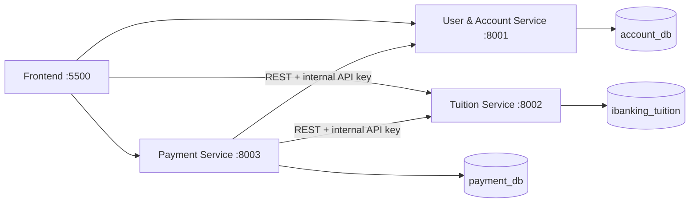

# iBanking Tuition Payment

A student microservices project for looking up university tuition and paying it with simulated iBanking accounts. Payment confirmation uses email OTP. It does not connect to a real bank, card network, or payment gateway.

## Architecture



Each backend accesses only its own database. The browser uses Bearer JWTs for protected user and payment operations. Payment calls the other services over REST; internal API keys stay on the backend.

## Technology

- Python, FastAPI, Uvicorn
- MySQL; SQLAlchemy for User and Payment, PyMySQL for Tuition
- Pydantic v2, JWT (`python-jose`), bcrypt, and `python-dotenv`
- SMTP email for OTP delivery
- Static HTML, CSS, and JavaScript frontend
- pytest and FastAPI `TestClient`

## Repository layout

```text
iBanking-Tuition-Payment/
├── backend/
│   ├── user_service/       # authentication, users, accounts
│   ├── tuition_service/    # student tuition lookup and status
│   └── payment_service/    # payments, transactions, OTP and email
├── db/
│   ├── user/               # account_db setup
│   ├── tuition/            # ibanking_tuition setup and claim table
│   └── payment/            # payment_db setup and migration
├── frontend/               # HTML pages, css/, js/, assets/
├── tests/
│   ├── user_service/
│   ├── tuition_service/
│   └── payment_service/
├── pytest.ini
└── README.md
```

## Requirements

Install Python 3.10 or newer and MySQL 8.x. Create and activate a virtual environment, then install each service's requirements from the repository root:

```powershell
python -m pip install -r backend/user_service/requirements.txt
python -m pip install -r backend/tuition_service/requirements.txt
python -m pip install -r backend/payment_service/requirements.txt
```

The local MySQL server must be running. SMTP credentials are needed for OTP email delivery.

## Database setup

Run these scripts in order from MySQL Workbench or a MySQL client:

1. `db/user/init.sql` creates `account_db`, its user/account tables, and demo records.
2. `db/tuition/tuition.sql` creates `ibanking_tuition`, tuition bills, and the payment-claim table for new databases.
3. `db/tuition/tuition_payment_claims.sql` is an idempotent setup script. Apply it to an existing Tuition database if the claim table is missing.
4. `db/payment/payment_init.sql` creates `payment_db`, transactions, and OTPs.
5. `db/payment/payment_add_student_name.sql` is only for an existing Payment database whose `transactions` table does not yet have `student_name`; do not rerun the `ALTER TABLE` after the column exists.

Database ownership is fixed: User Service → `account_db`; Tuition Service → `ibanking_tuition`; Payment Service → `payment_db`. Do not point a service at another service's database. The SQL seed includes the user `user01`, accounts `1012345678` and `1012345679`, and tuition records including `524H0104`. The seeded password is stored only as a bcrypt hash in SQL; use the password supplied for your local demo setup.

## Environment configuration

Each service loads its own `.env` beside its `config.py`. Copy the matching example file and set local values:

```powershell
Copy-Item backend/user_service/.env.example backend/user_service/.env
Copy-Item backend/tuition_service/.env.example backend/tuition_service/.env
Copy-Item backend/payment_service/.env.example backend/payment_service/.env
```

Use local MySQL credentials in each `DATABASE_URL` (User and Tuition) or `PAYMENT_DATABASE_URL` (Payment). The database names must remain `account_db`, `ibanking_tuition`, and `payment_db` respectively. User and Payment must share `JWT_SECRET_KEY` and `JWT_ALGORITHM`; all three services must share `INTERNAL_API_KEY`. Payment also reads `USER_SERVICE_URL`, `TUITION_SERVICE_URL`, `SMTP_HOST`, `SMTP_PORT`, `SMTP_USERNAME`, `SMTP_PASSWORD`, and `SMTP_FROM_EMAIL`.

`.env` files are local and ignored by Git. Never put real passwords, JWT secrets, internal keys, or SMTP credentials in `.env.example`, documentation, or frontend files. The examples contain placeholders only.

## Run the project

Run each command from the repository root in a separate terminal.

### User Service — port 8001

```powershell
python -m uvicorn backend.user_service.main:app --host 0.0.0.0 --port 8001
```

### Tuition Service — port 8002

```powershell
python -m uvicorn backend.tuition_service.main:app --host 0.0.0.0 --port 8002
```

### Payment Service — port 8003

```powershell
python -m uvicorn backend.payment_service.main:app --host 0.0.0.0 --port 8003
```

### Frontend — port 5500

```powershell
python -m http.server 5500 --directory frontend
```

Open <http://localhost:5500>. Health endpoints are `/health` on ports 8001, 8002, and 8003. Interactive API documentation is available at `/docs` on each backend port.

## API overview

### User Service (`:8001`)

| Method | Endpoint | Access |
| --- | --- | --- |
| `POST` | `/api/v1/auth/login` | Public |
| `GET` | `/api/v1/users/me` | Bearer JWT |
| `GET` | `/api/v1/accounts/me` | Bearer JWT |
| `GET` | `/api/v1/internal/accounts/{account_number}` | Internal API key |
| `POST` | `/api/v1/internal/accounts/{account_number}/debit` | Internal API key |

### Tuition Service (`:8002`)

| Method | Endpoint | Access |
| --- | --- | --- |
| `GET` | `/api/v1/tuition` | Public lookup |
| `GET` | `/api/v1/tuition/{student_id}` | Public lookup |
| `POST` | `/api/v1/tuition/{student_id}/claim` | Internal API key |
| `DELETE` | `/api/v1/tuition/{student_id}/claim/{transaction_id}` | Internal API key |
| `PUT` | `/api/v1/tuition/{student_id}/pay` | Internal API key |

Tuition responses use `student_id`, `student_name`, `amount`, and `status` (`UNPAID` or `PAID`).

### Payment Service (`:8003`)

| Method | Endpoint | Access |
| --- | --- | --- |
| `POST` | `/api/v1/payments` | Bearer JWT; creates a pending transaction |
| `POST` | `/api/v1/payments/{transaction_id}/otp` | Bearer JWT; requests email OTP |
| `POST` | `/api/v1/payments/confirm` | Bearer JWT; confirms with `transactionId` and `otpCode` |
| `GET` | `/api/v1/transactions/me` | Bearer JWT; caller's history |

For exact request and response examples, use the corresponding service's Swagger UI at `/docs`.

## Payment flow

```text
Login → look up tuition → select account → create PENDING transaction
→ request email OTP → confirm OTP → claim tuition
→ debit account → mark tuition PAID → transaction SUCCESS → history
```

The browser submits only the student ID and source account number when creating payment. Payment Service obtains the authoritative tuition amount from Tuition Service and derives the payer ID from the JWT.

## Security and concurrency

- Protected browser APIs use JWT Bearer authentication; payer identity comes from JWT `sub`.
- User passwords are stored as bcrypt hashes. Account lookup, debit, and tuition mutation require the backend internal API key.
- Payment Service checks account ownership and active status. Atomic conditional debit requires an active account and enough balance, preventing a negative balance.
- OTP has six digits, expires after five minutes, is not returned to the browser, and is consumed with an atomic one-time update.
- Tuition uses a unique per-student payment claim and a conditional `UNPAID` → `PAID` update. Payment claims its transaction as `PROCESSING` before side effects.
- These database operations protect the tested account, tuition, transaction, and OTP races. They do not form a distributed transaction across services.

## Tests and validation

Run the test suite and compile check from the repository root:

```powershell
pytest -q
python -m compileall -q backend tests
git diff --check
```

### Manual check list

- [ ] MySQL is running and all three databases exist.
- [ ] Each backend starts on its documented port and `/health` responds.
- [ ] Frontend starts at `http://localhost:5500`.
- [ ] Login, profile, and account list work.
- [ ] Tuition lookup returns student name, amount, and status.
- [ ] Payment creation, OTP email, and confirmation work.
- [ ] Wrong, expired, and reused OTPs are rejected.
- [ ] A successful payment reduces balance, marks tuition paid, and appears in history.

## Troubleshooting

- **MySQL access denied:** check the service-local `.env`, the username/password inside its database URL, MySQL host/port, and the database name. Tuition specifically reads its service-local `DATABASE_URL` and uses the URL credentials to open its PyMySQL connection.
- **Port already in use:** identify and stop the existing process listening on 8001, 8002, 8003, or 5500 before starting the service again.
- **OTP email not sent:** check Payment Service's SMTP host, port, sender, username, and app password. The sender variable is named `SMTP_FROM_EMAIL`.
- **Service-to-service call fails:** verify all three backends are running and Payment's `USER_SERVICE_URL`, `TUITION_SERVICE_URL`, and shared internal API key match the local configuration.
- **Browser request fails:** open the matching `/docs` endpoint and confirm the browser is using the expected backend port and a valid session.

## Known limitations

Services communicate synchronously over REST; there is no distributed transaction coordinator or automatic refund. If account debit succeeds but Tuition update or Payment finalization fails, manual reconciliation may be required. A process crash can also leave a transaction `PROCESSING` or a Tuition claim that needs recovery; claims do not expire automatically. Payment Service sends OTP email directly; there is no Notification Service.
